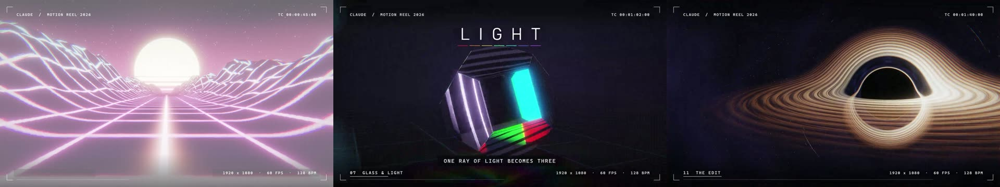
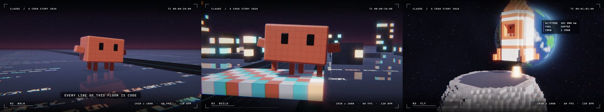
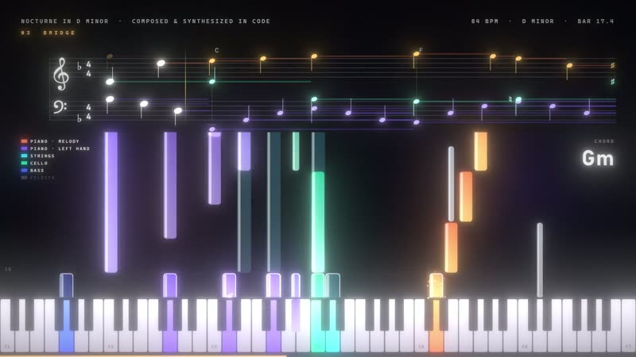
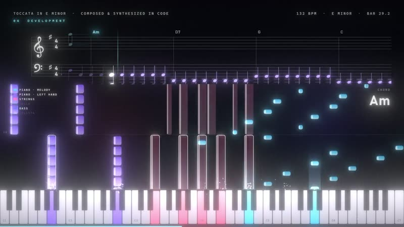
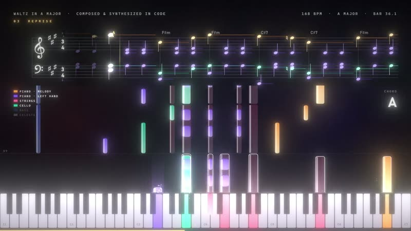
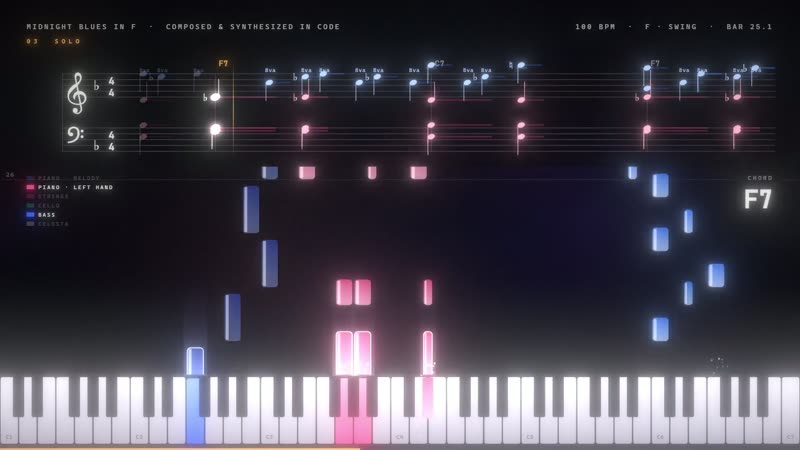
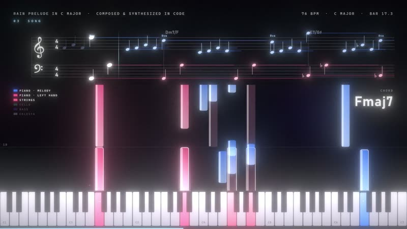
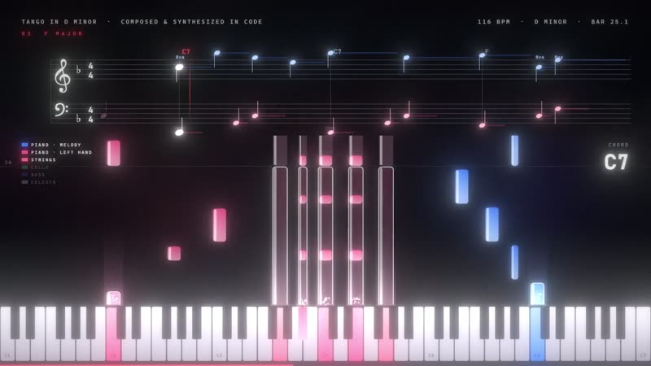
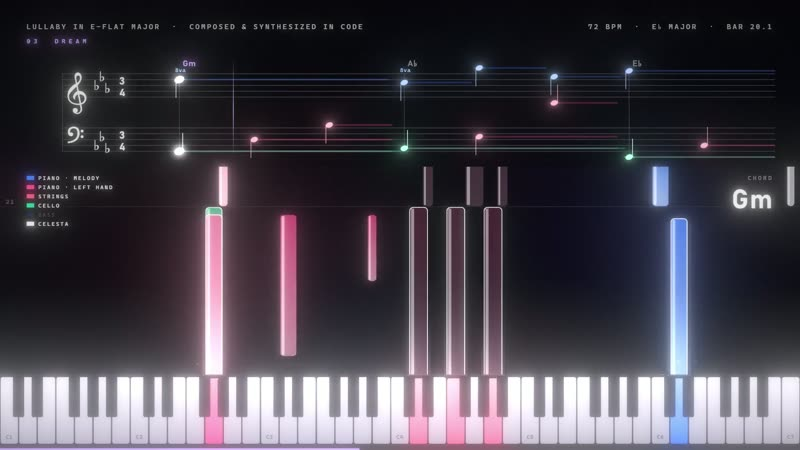

# Videos and Music in Code

Two films and seven pieces of music made entirely in code. No video editor, no 3D package, no samples, no stock footage:
every frame is drawn by shaders and canvas code in a hidden Chromium, every sound is synthesized sample by sample in
JavaScript, and the picture and the music read the same timeline.

[Русская версия](README.ru.md)

[](#) [](LICENSE) [](https://developer.mozilla.org/docs/Web/JavaScript) [](https://claude.com/claude-code)

Code, tests and docs are written by Claude (Anthropic) in Claude Code. Ideas, testing and decisions - Alexey.

**What is here:** the source code and poster frames. The finished videos stay out of git (a film is 1.9-2.4 GB in 1080p
60 fps and 5.5-7.4 GB in 4K 240 fps; a piece of music is 50-80 MB) and are not uploaded yet. A third film, "Alexey's Projects 2026", is still in progress and is not
here yet.

## Films

### Showreel 2026 - 2:00, 128 BPM, A minor



Thirteen scenes cut to the beat: code typing itself, kinetic type, a Mandelbulb fractal, a black hole, a synthwave terrain,
a city of repeated boxes, a glass prism with dispersion, liquid metal, a tunnel, particles and a montage. 3D is ray marching
of signed distance fields; four sub-frames per frame give motion blur. Kicks, claps and impacts in the music come from the
same scene list, so cuts land on the beat. Readability is checked by laws: every caption stays long enough to read, keeps
5 % margins, never sits on a flash, and has 3:1 (large) or 4.5:1 (small) contrast against the actual frame behind it.

Code: [reels/showreel](reels/showreel)

### A Crab Story - 1:32, 120 BPM



The pixel crab (Claude's avatar) wakes up in a terminal (`$ claude`), assembles itself from nine parts, walks sideways on a
floor made of lines of code, throws 60 blocks into a bridge, grows a city on every beat, prints a rocket layer by layer like
a 3D printer, flies to the Moon, dances on a glowing floor and sits watching the Earth. Everything is voxels traversed with
DDA in a shader, the flame and smoke are volumes; the chiptune-flavoured score is synthesized too. `?ph=1` renders the
version where a 3D printer head prints the rocket.

Code: [reels/crab-story](reels/crab-story)

## Music

Each piece is a score in code (`song.js`, one source of notes for both the sound and the picture), a synthesizer
(`synth2.cjs`: an additive piano with inharmonic overtones and three strings per note, strings, cello, bass, celesta,
timpani) and a visualization (`viz.js`): a real staff with key signatures and note spelling, falling notes, a keyboard and
sparks.

| | Piece | Length | Tempo | What to listen for |
|---|---|---|---|---|
|  | [Nocturne in D minor](music/nocturne-in-d-minor) | 1:47 | 84 BPM | The first one: about 600 notes, piano with strings, bass and celesta |
|  | [Toccata in E minor](music/toccata-in-e-minor) | 1:54 | 132 BPM | Running sixteenths in the right hand, the theme in octaves below, timpani at the climax |
|  | [Waltz in A major](music/waltz-in-a-major) | 1:24 | 168 BPM, 3/4 | Theme, the theme higher with strings and cello, a middle part in F-sharp minor, full orchestra |
|  | [Midnight Blues in F](music/midnight-blues-in-f) | 2:08 | 100 BPM, swing | Twelve-bar jazz blues: walking bass, Charleston-rhythm chords, brushes, two solo choruses |
|  | [Rain Prelude in C major](music/rain-prelude-in-c-major) | 1:57 | 76 BPM | One broken chord per bar falling like drops; a melody grows out of the top voice |
|  | [Tango in D minor](music/tango-in-d-minor) | 1:51 | 116 BPM | Habanera bass, sharp 3-3-2 chords, a cello countermelody, the closing "chan-chan" |
|  | [Lullaby in E-flat major](music/lullaby-in-e-flat-major) | 1:47 | 72 BPM, 3/4 | A music box sings the theme over rocking piano, and slows down at the end |

## Render it yourself

You need Windows (the captions use the Bahnschrift and Cascadia Mono fonts), Node.js 18+, ffmpeg in PATH and a GPU:
Chromium runs headless with `--use-angle=d3d11 --enable-gpu`.

```
npm install
npx playwright install chromium
```

A film (in `reels/showreel` or `reels/crab-story`):

```
node synth.cjs                          # the music -> WAV
node render.cjs preview t=10,20.5       # single frames into preview/
node render.cjs full res=1080 fps=60    # the picture -> video_1080_60.mp4
sh mux.sh 1080 60                       # picture + music (-14 LUFS) and a light copy, one folder up
sh render4k.sh                          # 4K 240 fps in parallel parts
node render.cjs text fps=30                         # caption laws only (no GL), fast
node render.cjs check res=1080 fps=10 sub=1 ss=1    # contrast laws on real frames, report in check/
```

A piece of music (in `music/<piece>`):

```
node synth2.cjs                         # the score -> WAV
node render2.cjs preview 300,1200       # frames 300 and 1200 into preview/
node render2.cjs full                   # the picture -> video.mp4, 1080p 60 fps
node render4.cjs res=2160 fps=240       # the same in 4K 240 fps
sh ../../tools/mux_music.sh .           # picture + music -> <piece>.mp4 and a light copy
```

Speed on an RTX 5060 Ti: about 0.1 s per 1080p frame for the music and 0.45-0.65 s for the films, so a full 1080p60
render takes about 12 minutes for a piece and about an hour for a film; 4K 240 fps takes hours.

## Where the code comes from

The works are made in a media folder outside this repository. `tools/sync_from_media.sh` copies only the code from there
(and, with `--posters`, the frames in `docs/`), turns the local Playwright path into `require('playwright')` and fails if an
absolute path is left. WAV, frames and MP4 files never get into git (`.gitignore`).

## License

MIT for the code in this repository.
