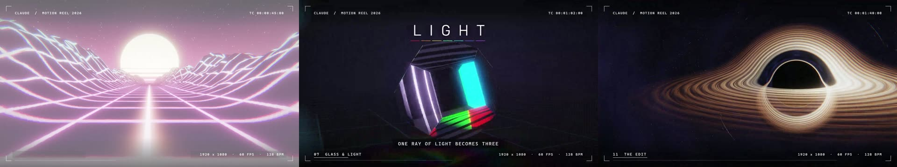
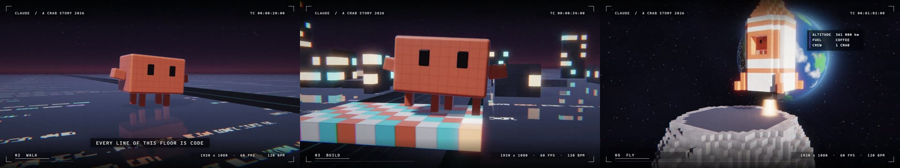
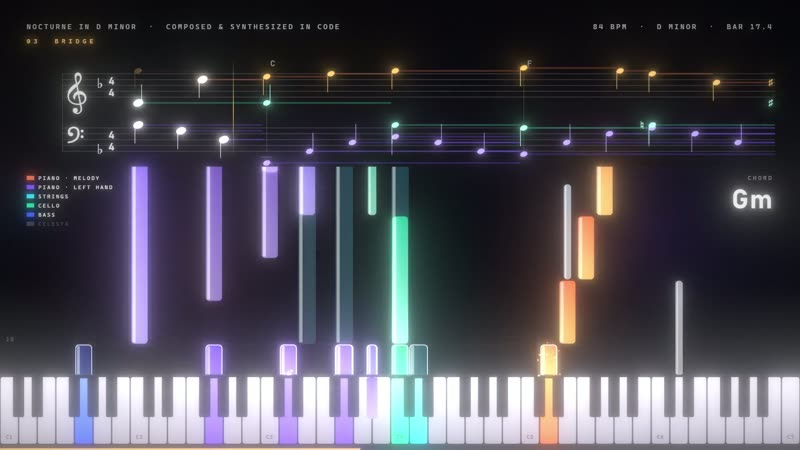
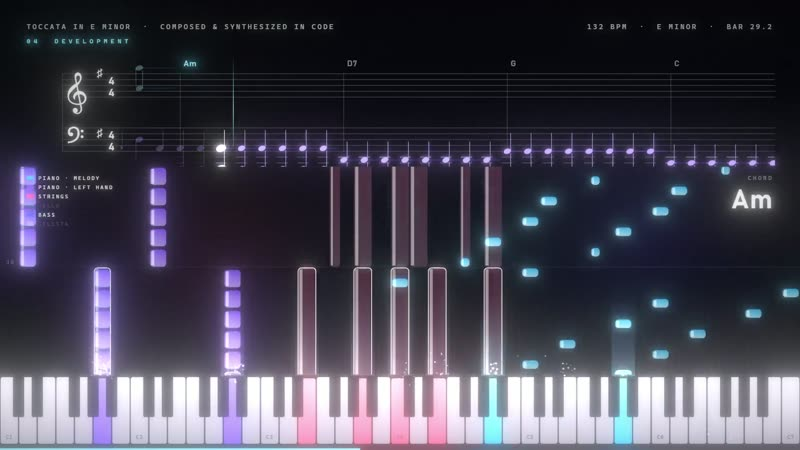
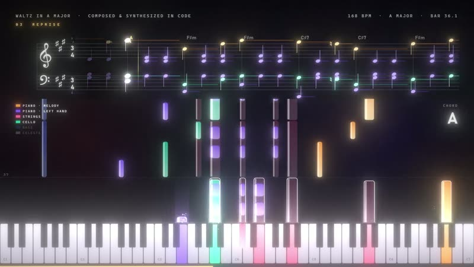
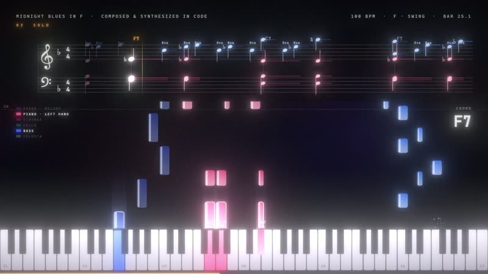
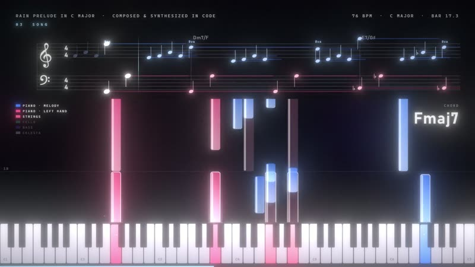
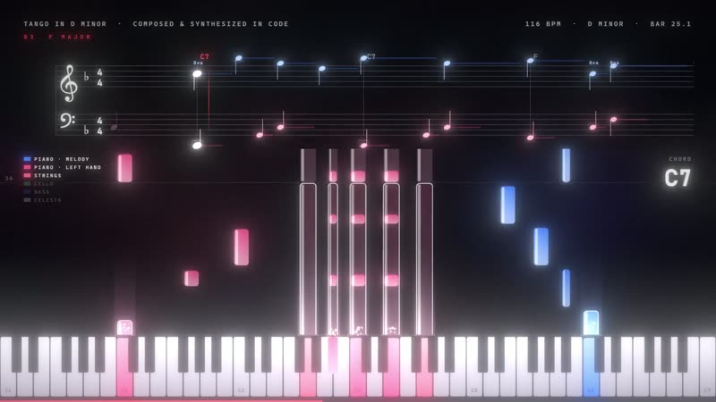
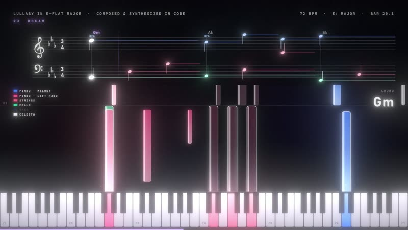

# Видео и музыка кодом

Два фильма и семь музыкальных пьес, сделанные целиком кодом. Без видеоредактора, 3D-пакета, сэмплов и стоковых кадров:
каждый кадр рисуют шейдеры и canvas в скрытом Chromium, каждый звук синтезируется по отсчётам на JavaScript, а картинка
и музыка читают одну и ту же разметку времени.

[English](README.md)

[](#) [](LICENSE) [](https://developer.mozilla.org/docs/Web/JavaScript) [](https://claude.com/claude-code)

Код, тесты и документация этого проекта написаны Claude (Anthropic) в Claude Code. Идеи, проверка и решения - Алексей.

**Что здесь лежит:** исходный код и кадры-обложки. Готовые видео в git не кладутся (фильм весит 1,9-2,4 ГБ в 1080p
60 к/с и 5,5-7,4 ГБ в 4K 240 к/с, пьеса - 50-80 МБ) и пока не выложены. Третий фильм, «Проекты Алексея 2026», ещё в работе, его здесь нет.

## Фильмы

### Шоурил 2026 - 2:00, 128 BPM, ля минор



Тринадцать сцен под удары музыки: код, который печатает сам себя, кинетическая типографика, фрактал Мандельбульб, чёрная
дыра, синтвейв-рельеф, город из повторённых коробок, стеклянная призма с дисперсией, жидкий металл, туннель, частицы
и монтаж. 3D - лучевой марш по полям расстояний, четыре подкадра на кадр дают размытие движения. Бочка, хлопки и удары
в музыке выводятся из того же списка сцен, поэтому склейки попадают в долю. Читаемость проверяют законы: каждая надпись
держится достаточно долго, чтобы её прочесть, не заходит в поля 5 %, не стоит на вспышке и имеет контраст 3:1 (крупная)
или 4,5:1 (мелкая) с настоящим фоном кадра за ней.

Код: [reels/showreel](reels/showreel)

### A Crab Story - 1:32, 120 BPM



Пиксельный крабик (аватарка Claude) просыпается в терминале (`$ claude`), собирается из девяти деталей, идёт боком по полу
из строк кода, бросает 60 блоков в мост, растит город на каждую долю, печатает ракету слоями, как 3D-принтер, летит на Луну,
танцует на светящемся полу и сидит, глядя на Землю. Всё - воксели, которые шейдер обходит методом DDA, пламя и дым -
объёмом; музыка с чиптюном тоже синтезирована. `?ph=1` рисует версию, где ракету печатает головка 3D-принтера.

Код: [reels/crab-story](reels/crab-story)

## Музыка

Каждая пьеса - это партитура кодом (`song.js`, один источник нот и для звука, и для картинки), синтезатор (`synth2.cjs`:
аддитивное фортепиано с неидеальными обертонами и тремя струнами на ноту, струнные, виолончель, бас, челеста, литавры)
и визуализация (`viz.js`): настоящий нотный стан с ключевыми знаками и правописанием нот, падающие ноты, клавиатура и искры.

| | Пьеса | Длина | Темп | Что слушать |
|---|---|---|---|---|
|  | [Nocturne in D minor](music/nocturne-in-d-minor) | 1:47 | 84 BPM | Первая: около 600 нот, фортепиано со струнными, басом и челестой |
|  | [Toccata in E minor](music/toccata-in-e-minor) | 1:54 | 132 BPM | Бегущие шестнадцатые правой руки, тема в октавах внизу, литавры в кульминации |
|  | [Waltz in A major](music/waltz-in-a-major) | 1:24 | 168 BPM, 3/4 | Тема, тема выше со струнными и виолончелью, середина в фа-диез миноре, весь оркестр |
|  | [Midnight Blues in F](music/midnight-blues-in-f) | 2:08 | 100 BPM, свинг | Джазовый блюз в 12 тактов: шагающий бас, аккорды в ритме чарльстона, щётки, два соло |
|  | [Rain Prelude in C major](music/rain-prelude-in-c-major) | 1:57 | 76 BPM | Один разложенный аккорд на такт падает, как капли; из верхнего голоса вырастает мелодия |
|  | [Tango in D minor](music/tango-in-d-minor) | 1:51 | 116 BPM | Хабанера в басу, острые аккорды 3-3-2, встречный голос виолончели, финальное «чан-чан» |
|  | [Lullaby in E-flat major](music/lullaby-in-e-flat-major) | 1:47 | 72 BPM, 3/4 | Шкатулка поёт тему над качающимся фортепиано и в конце замедляется |

## Отрендерить самому

Нужны Windows (подписи набраны шрифтами Bahnschrift и Cascadia Mono), Node.js 18+, ffmpeg в PATH и видеокарта: Chromium
работает без окна с `--use-angle=d3d11 --enable-gpu`.

```
npm install
npx playwright install chromium
```

Фильм (в `reels/showreel` или `reels/crab-story`):

```
node synth.cjs                          # музыка -> WAV
node render.cjs preview t=10,20.5       # отдельные кадры в preview/
node render.cjs full res=1080 fps=60    # картинка -> video_1080_60.mp4
sh mux.sh 1080 60                       # картинка + музыка (-14 LUFS) и лёгкая копия, на папку выше
sh render4k.sh                          # 4K 240 к/с параллельными кусками
node render.cjs text fps=30                         # только законы надписей (без GL), быстро
node render.cjs check res=1080 fps=10 sub=1 ss=1    # законы контраста по настоящим кадрам, отчёт в check/
```

Пьеса (в `music/<пьеса>`):

```
node synth2.cjs                         # партитура -> WAV
node render2.cjs preview 300,1200       # кадры 300 и 1200 в preview/
node render2.cjs full                   # картинка -> video.mp4, 1080p 60 к/с
node render4.cjs res=2160 fps=240       # то же в 4K 240 к/с
sh ../../tools/mux_music.sh .           # картинка + музыка -> <пьеса>.mp4 и лёгкая копия
```

Скорость на RTX 5060 Ti: около 0,1 с на кадр 1080p у музыки и 0,45-0,65 с у фильмов, то есть полный рендер 1080p60
идёт около 12 минут для пьесы и около часа для фильма; 4K 240 к/с - часы.

## Откуда берётся код

Работы делаются в папке медиа вне этого репозитория. `tools/sync_from_media.sh` копирует оттуда только код (а с `--posters`
ещё кадры в `docs/`), меняет локальный путь к Playwright на `require('playwright')` и падает, если остался абсолютный путь.
WAV, кадры и MP4 в git не попадают (`.gitignore`).

## Лицензия

MIT для кода в этом репозитории.
